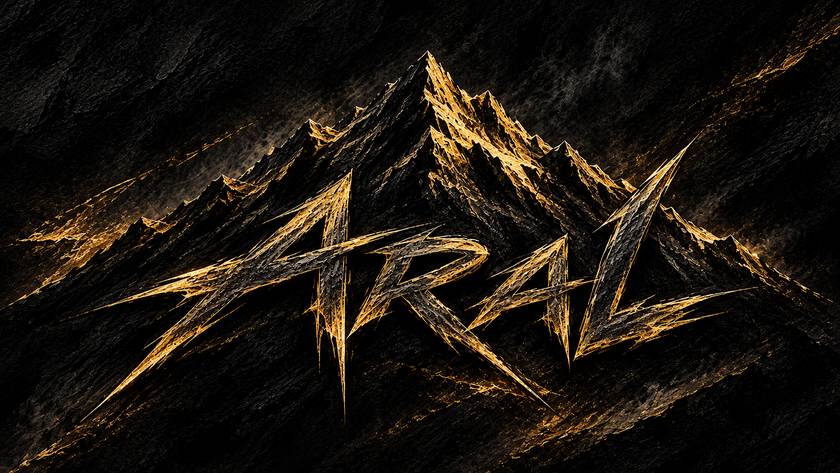

<div align="center">



# ARAL · V3.0 — OBSIDIAN & GOLD

**پنل آزاد و رایگانِ مدیریت اشتراک VLESS، Trojan و پروکسی رسمی تلگرام روی شبکهٔ ابری کلادفلر**
*Free Serverless VLESS, Trojan, Fragment & Official Telegram Web Proxy Panel on Cloudflare Workers & Pages*

  

[کانال رسمی / Official Channel — Telegram](https://t.me/AralDev)

</div>

---

> ### اطلاعیه (رایگان و غیرقابل فروش)
> **ARAL** نرم‌افزار آزاد و رایگان است؛ خرید و فروش سورس، پنل یا لینک اشتراکِ ساخته‌شده با آن مجاز نیست.
> **ARAL is free software — strictly not for sale.**

---

## ویژگی‌ها / Features

- **پنل چندکاربره با KV کلادفلر** — ساخت و مدیریت مشترکین، حجم، انقضا و وضعیت خط
  *Multi-user KV panel: subscribers, quotas, expiry, line status*
- **VLESS + Trojan روی WebSocket** با Fragment (۱-۱ و tlsHello) ضد DPI
  *VLESS + Trojan over WS with anti-DPI Fragment profiles*
- **اشتراک هوشمند چندقالبی** — Base64، Xray JSON، Sing-box، Clash/Mihomo + ایمپورت یک‌ضرب به v2rayNG، Hiddify، Streisand و…
  *Smart multi-format subscriptions + one-tap client import*
- **پروکسی رسمی تلگرام** (`tg://webproxy`) بدون برنامه جانبی
  *Official Telegram Web Proxy — no extra app*
- **DoH خصوصی** برای هر مشترک (`/dns-query/<token>`)
  *Per-subscriber Private DoH endpoint*
- **اسکنر IP تمیز** + رنج‌های رسمی کلادفلر و مشاور هوشمند ISP
  *Clean-IP scanner, official CF ranges, smart ISP advisor*
- **نوسان‌نگار زنده** پینگ/سرعت و مانیتور سهمیهٔ روزانهٔ کلادفلر
  *Live RTT/speed telemetry + CF daily quota monitor*
- **تم Obsidian & Gold** با کلید انتخاب **دارک / لایت** (ذخیرهٔ انتخاب کاربر)
  *Obsidian & Gold theme with dark/light toggle (persisted)*
- **دوزبانه (فارسی/انگلیسی)** و رابط موبایل‌پسند
  *Bilingual FA/EN, mobile-friendly UI*
- **پشتیبان‌گیری/بازیابی JSON** و بروزرسانی هسته از مخزن رسمی
  *JSON backup/restore + core self-updater*

## تایپوگرافی و هویت / Typography & Identity

| نقش | فونت |
| --- | --- |
| تیترها / Headings | **DM Serif Display** |
| متن لاتین / Body (latin) | **Bodoni Moda** |
| فارسی / Farsi | **Vazirmatn** |
| کد و اعداد فنی / Mono | **JetBrains Mono** |

لوگوی قلهٔ آرال (ابسیدین و طلا) در سربرگ پنل، صفحهٔ کارت اشتراک و نشانِ مهر تعبیه شده است.
*The ARAL obsidian-summit emblem is embedded in the panel masthead, the subscriber press-pass and the seal stamp.*

## استقرار سریع — Workers / Quick Deploy (Workers)

1. در کلادفلر یک **KV namespace** با نام `aral` بساز.
2. یک Worker جدید بساز (Hello World) و کل محتوای `worker-single-file.js` را در **Edit code** جای‌گذاری و **Deploy** کن.
3. از **Settings → Bindings → KV namespace** متغیر `KV` را به فضای `aral` وصل کن.
4. صفحهٔ پنل را باز کن — فرم انتخاب رمز مدیر ظاهر می‌شود.

*Full English steps are rendered inside the panel itself (stateless view).*

## استقرار — Pages / Deploy (Pages)

پوشهٔ `aral-pages.zip` را در **Workers & Pages → Create → Pages → Upload assets** آپلود کن؛ شامل `index.html` و `_worker.js` است.

## توسعهٔ محلی / Local Development

```bash
npm install          # نصب وابستگی‌ها / install dependencies
npm run build        # ساخت worker-single-file.js + panel-preview.html + dist/
npm run dev          # اجرای محلی با wrangler
npm test             # تست E2E با playwright
```

## بروزرسانی هسته / Core Self-Updater

پنل به‌صورت پیش‌فرض نسخهٔ جدید را از مخزن `AralDev/Aral` بررسی و نصب می‌کند (فایل `worker-single-file.js` شاخهٔ `main`). اگر مخزن شخصی خودت را می‌خواهی، ثابت‌های `GITHUB_REPO` را در `src/storage.js` و `OFFICIAL_GITHUB_REPO` را در `src/ui/app.js` تغییر بده.

*The updater checks `AralDev/Aral` (branch `main`) — point those two constants at your own fork if needed.*

## ساختار مخزن / Repository Layout

```
├─ build.mjs               # پایپ‌لاین ساخت (فونت‌سابی، فشرده‌سازی، استلث)
├─ worker-single-file.js   # خروجی نهایی برای Workers
├─ aral-pages.zip          # بستهٔ آمادهٔ Pages
├─ wrangler.toml / config.json
├─ src/
│  ├─ worker.js            # ورودی Worker (API + مسیریابی)
│  ├─ sub.js               # مولد اشتراک و کارت مشترک
│  ├─ protocols.js         # موتور تونل VLESS/Trojan + DoH
│  ├─ tgproxy.js           # پروکسی رسمی تلگرام
│  ├─ storage.js           # لایهٔ KV و ثابت‌های برند
│  ├─ crypto.js            # توابع رمزنگاری
│  └─ ui/                  # رابط کاربری (HTML/CSS/JS + فونت‌ها)
└─ assets/                 # لوگو، مهر، اسکایلاین
```

---

<div align="center">

**ARAL V3.0 · OBSIDIAN & GOLD** · [t.me/AralDev](https://t.me/AralDev) · FREE · NOT FOR SALE

</div>
